# Viisi accessibility review

Reviewed October 13, 2026 against WCAG 2.0 Level AA. The reviewed scope has zero automated violations in 48 page/scenario checks, with additional keyboard, pointer, dialog, motion, and enlarged-text checks. This review does not certify full conformance: real screen-reader speech, mobile device behavior, other browsers, and the deployed site still need validation.

At your request, the animated phone in `index.html` is excluded. Its markup, script, and dedicated styling were returned to their pre-audit state; you plan to remove it. The current homepage still has horizontal overflow from its decorative phone cards and three HTML validation findings within that excluded block: misused `aria-label`, an unencoded ampersand, and a focusable button under `aria-hidden`. Retest the whole homepage after removal.

The target includes both Level A and AA requirements. Normal text needs at least 4.5:1 contrast; large text needs at least 3:1. Automated testing must be combined with human evaluation. [W3C WCAG 2.0](https://www.w3.org/TR/WCAG20/)

The review used the local repository in Chrome. The in-app browser was unavailable. Temporary audit tooling ran outside the repository; no application dependencies or build system were added. Light mode and reduced motion were tested through local media-preference fixtures. The 200% text check doubled the document's base font size; it does not replace testing actual browser zoom or mobile magnification.

| Step | Surface and user task | Result |
| --- | --- | --- |
| 1 | Homepage: understand Viisi and navigate the site | Automated checks clear outside the excluded animation; whole-page overflow remains until its removal |
| 2 | Demo: enter letters, shuffle, delete, recover from errors, use hints, view results | Keyboard and pointer play verified; focus, feedback, score, and modal behavior checked |
| 3 | Guide: read rules and follow navigation | Automated checks clear; enlarged-text reflow checked |
| 4 | Scoring: read formulas, hints, and achievement rules | Automated checks clear; invalid and unclosed markup repaired; reflow checked |
| 5 | Badges: read achievements and descriptions | Automated checks clear; label contrast and enlarged-text wrapping checked |
| 6 | Privacy: read the policy and contact support | Automated checks clear; skip navigation and enlarged-text wrapping checked |
| 7 | Comparison: read the table and open FAQ disclosures | Automated checks clear; scrollable table region is named and keyboard-focusable |
| 8 | Legacy frame preview: identify the page and return home | Title, main landmark, heading, and return link present; automated checks clear |
| 9 | Download redirect: reach the App Store | Fallback HTML validated; external destination excluded from the audit |

The strongest existing features were native links and buttons, descriptive App Store image alternatives, ordinary FAQ disclosure controls, and text-based game feedback. Changes retained the existing palette, layout patterns, puzzle data, scoring, storage, and main navigation model.

The confirmed issues and their remedies were:

1. **Contrast (1.4.3).** White text on bright red buttons measured 3.43:1. Buttons now use the existing darker red token. The dark green token was adjusted for labels and scoring text. Game tiles use dark lettering on bright red and green backgrounds. Light-mode feedback and delete controls were also corrected.
2. **Document structure and navigation (1.3.1, 2.4.1, 2.4.2, 2.4.5, 3.1.1, 4.1.1).** The homepage lacked its opening HTML element and language declaration. The demo duplicated IDs in unused mobile markup. Scoring had malformed markup and unclosed containers. These were repaired, and repeated-navigation pages now provide skip links and named mobile navigation. The shared footer provides a complete list of marketing pages, including previously missing Badges and Scoring links, alongside existing navigation and contextual links. This follows the small-site approach described in [W3C technique G185](https://www.w3.org/TR/WCAG20-TECHS/G185.html).
3. **Keyboard operation and focus (2.1.1, 2.1.2, 2.4.3, 2.4.7).** Letter buttons previously disappeared and were recreated on each input. They now keep their identity and focus. Space retains native button activation, shortcuts respect modifier keys and game focus, and navigation closes with Escape. Focus moves to a visible control when navigation switches between mobile and desktop.
4. **Game understanding and results (1.3.1, 3.3.1, 3.3.2, 4.1.2).** The playable game was hidden from assistive technology. It is now exposed as a native table with labeled rows and cells, named icon controls, instructions, and useful status messages. Results announce the final score, move focus to the close button, make the background inert, contain Tab focus, and restore focus on close. The results sheet scrolls below the sticky header after opening, including with reduced motion and enlarged text.
5. **Reduced motion.** Shared CSS animation and transitions, playable-game tile motion, and game confetti are suppressed for reduced motion. The homepage phone animation is excluded at your request; no fix or conformance claim is made for it.
6. **Text resizing (1.4.4).** Enlarged text exposed overlapping cards, overflowing grid tracks, cropped game layouts, and hidden headings/instructions. Flexible columns, wrapping, content-based game heights, and retained mobile instructions corrected the observed failures. The excluded homepage phone cards still overflow; their planned removal needs a whole-page recheck.

The scanner flags manual contrast review where gradients or images prevent it from determining a background. Those items are retained in `results.json`; they were not suppressed. A supplementary calculation sampled the actual body gradients with a conservative 8% white glass layer: the muted text's lowest modeled contrast was 4.73:1. The image-backed homepage callout now uses an overlay of at least 86%, which preserves sufficient contrast even against a white image region. These calculations cover those shared colors and surfaces; they do not establish contrast for every decorative pixel or replace a visual check on other devices.

| Scenario | Viewport / fixture | Pages checked | Automated violations |
| --- | --- | --- | --- |
| Mobile dark | 375 × 812 | 8 | 0 |
| Mobile light, reduced motion | 375 × 812; media fixture | 8 | 0 |
| Enlarged text | 375 × 812; 200% base font size | 8 | 0 |
| Narrow dark | 320 × 720 | 8 | 0 |
| Desktop dark | 1280 × 900 | 8 | 0 |
| Desktop light, reduced motion | 1280 × 900; media fixture | 8 | 0 |

Additional interaction checks passed:

- Skip-link activation moved focus to the main content.
- Space and Enter activated letter buttons without losing their focus; Backspace removed a letter.
- Keyboard and pointer input completed all five words. A run without hints scored 120; a run with one hint scored 110.
- Invalid and duplicate guesses preserved readable error feedback and did not award points. Shuffling remained functional.
- Hints became available after three accepted words and disclosed their filled prefix.
- Results initially focused the close button. Its bounds were below the sticky header in both ordinary and 200% text layouts. Tab and Shift+Tab stayed inside results, and Escape restored focus and background interaction.
- Reduced-motion results showed the final score directly and generated zero confetti elements.
- Mobile navigation opened with Space, closed with Escape, and preserved a visible focus location across the 900px breakpoint.
- The seven fully reviewed pages had no document-level horizontal overflow after the final reflow corrections. Homepage overflow remains associated with its excluded phone block. The comparison table retains its own intentional scrolling region.

Commands and tools used, with results:

- `python3 -m http.server 4173 --bind 127.0.0.1` — local preview served successfully.
- `npm install --prefix /tmp/viisi-accessibility --no-audit --no-fund axe-core html-validate` — installed temporary audit tools outside the project.
- `axe.run(context, { preload: false, runOnly: { type: 'tag', values: ['wcag2a', 'wcag2aa', 'best-practice'] } })` — axe-core 4.14.0; all 48 recorded scans had zero in-scope violations. On the homepage, `context` explicitly excludes `.hero > .phone-showcase`; other pages use the whole document. Gradient/image contrast items remain explicitly marked for manual review.
- HTML Validate's `validateFile` API — eight complete pages passed; the homepage has the three excluded-block findings listed above. `validateString` passed for the homepage with only that block omitted in a temporary validation input. Checks use recommended rules with allowances for the repository's existing formatting conventions: lowercase doctype, self-closing void elements, inline styles, quote style, trailing whitespace, and long metadata titles.
- `node --check assets/js/main.js`, `node --check assets/js/demo.js` — passed.
- Python local-link and asset checks — all referenced local HTML destinations and assets existed on all nine pages; the nonexistent sitemap destination was removed.
- `git diff --check` — passed.
- Configured formatter, linter, typechecker, and test-suite commands — skipped because this static repository has no such configuration. No existing tests were removed or weakened.

Initial scans and interaction checks found the contrast, missing-language, hidden-focus, duplicate-ID, malformed-markup, reflow, and dialog-focus failures described above. The in-scope failures were corrected and rechecked; the phone-block findings remain excluded. Early audit scans also encountered external stylesheet preloading delays; the final harness inspected rendered styles with engine preloading disabled.

Not verified: VoiceOver, NVDA, or TalkBack speech and browse-mode behavior; Safari/Firefox accessibility trees; actual browser zoom and iOS pinch zoom; physical device orientation, touch, and magnification; production deployment and caching; App Store and YouTube accessibility. In particular, the table's CSS layout should be checked with Safari and VoiceOver before making a formal conformance claim. Automated results and screenshots do not establish every WCAG success criterion.

Risks and follow-ups: remove the excluded homepage animation and retest the complete homepage, complete those assistive-technology and device checks, then retest the deployed pages before publishing a conformance statement. The legacy frame preview remains visually minimal. No repository-guidance conflict was found. No commit, push, or deployment was performed.

Changed files, one line each:

| File | Change and reason |
| --- | --- |
| `index.html` | Restored language markup; added skip navigation and complete named footer navigation; phone animation excluded |
| `demo.html` | Removed duplicate unused markup; exposed the game; added native table markup, labels, instructions, and an accessible score |
| `how-to-play.html` | Added accessible navigation and corrected enlarged-text card/grid reflow |
| `score.html` | Added accessible navigation; repaired invalid markup and closed the main landmark |
| `badges.html` | Added accessible navigation and encoded heading punctuation correctly |
| `privacy.html` | Added skip navigation and mobile navigation semantics; retained policy content |
| `wordle-alternative/index.html` | Added accessible navigation and a named keyboard-focusable comparison region |
| `component.html` | Added a title, main landmark, heading, and return link to the legacy preview |
| `download/index.html` | Added a main landmark to the redirect fallback |
| `assets/css/styles.css` | Corrected shared contrast, focus, skip links, motion, image overlay, wrapping, and responsive layouts |
| `assets/css/demo.css` | Corrected game contrast, table layout, text scaling, dialog visibility, and focus scrolling |
| `assets/css/badges.css` | Allowed badge descriptions to wrap at larger text sizes |
| `assets/js/main.js` | Added Escape, link-close, and responsive navigation focus behavior |
| `assets/js/demo.js` | Preserved button focus; added semantic board output, useful status text, shortcut boundaries, and accessible dialog handling |
| `sitemap.xml` | Removed a destination that did not exist |
| `docs/accessibility/AUDIT.md` | Recorded scope, findings, evidence, checks, and remaining validation |
| `docs/accessibility/results.json` | Preserved the 48 automated scan summaries and unresolved engine review items |
| `docs/accessibility/screenshots/` | Preserved accepted before/after and results screenshots from this audit |

Accepted screenshots are presented in page order below. Each shows the actual locally rendered site; the results screenshot supplements Step 2. The download step has no captured site screen because it immediately leaves for the external App Store.

**Step 1 — Homepage.** Navigation and calls to action are clear. The phone animation shown at the right is excluded from this review and still causes horizontal overflow; it is scheduled for removal by you.

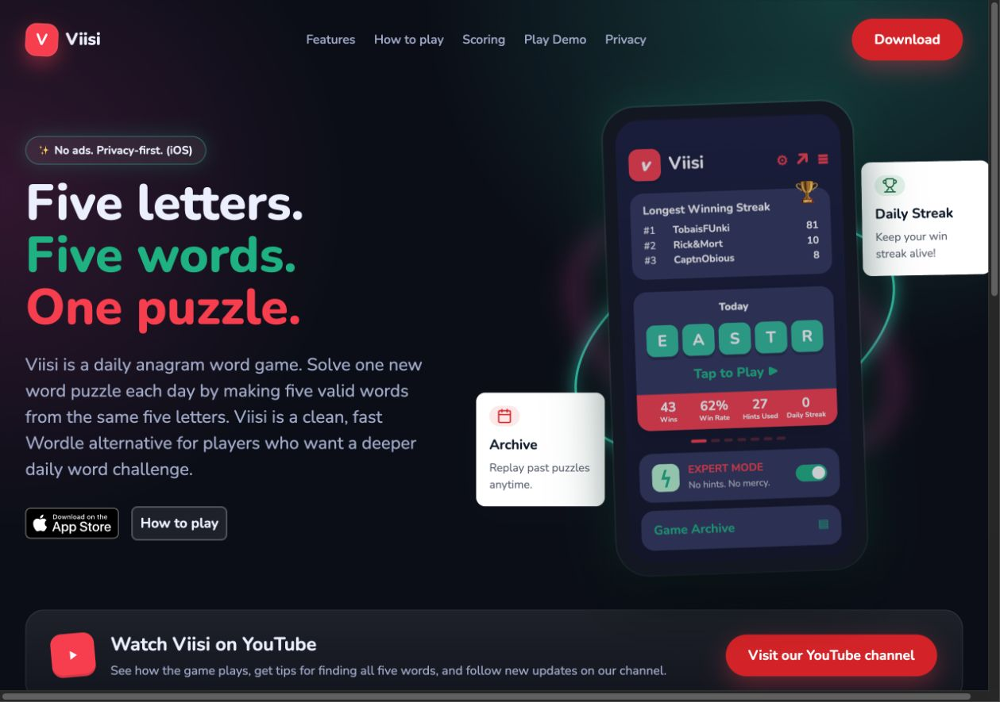

**Step 2 — Demo.** Instructions and the board are visible. The full game can scroll into view; keyboard, error, hint, and results behavior were tested separately.

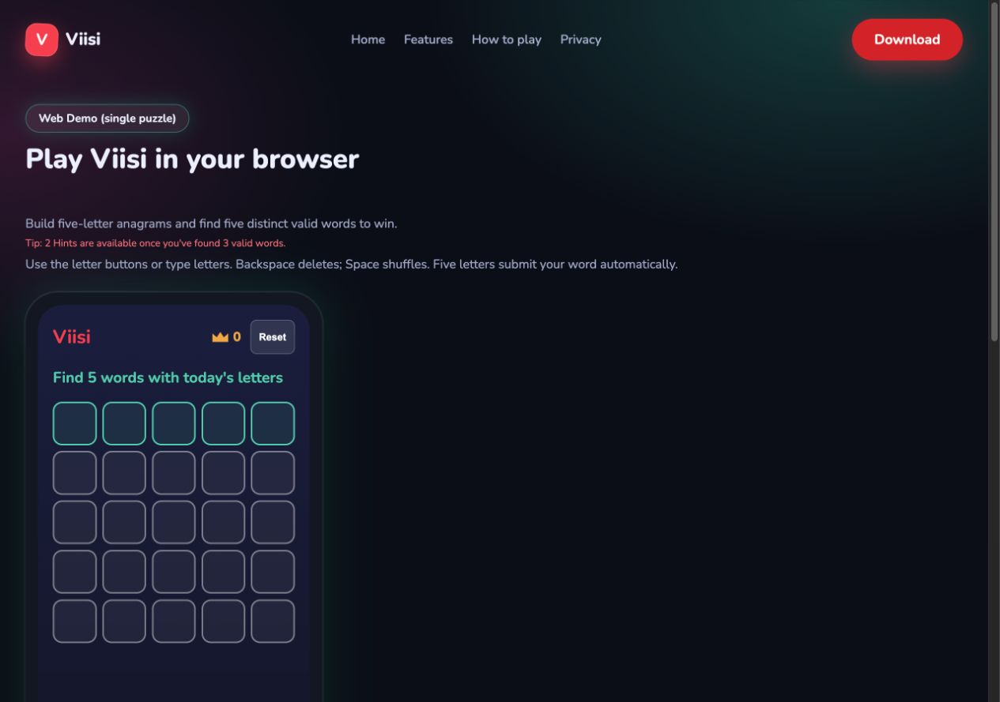

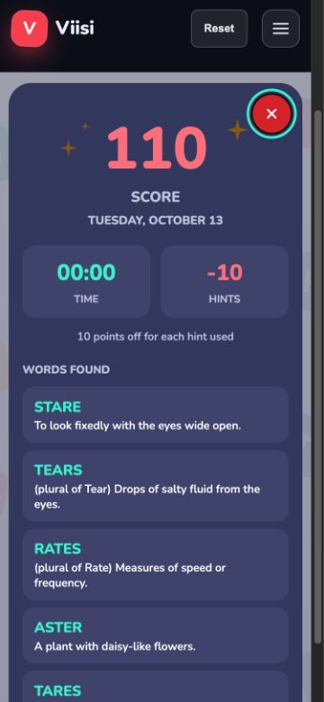

**Step 3 — Guide.** Rules use headings and lists; navigation and enlarged-text layouts passed the focused checks.

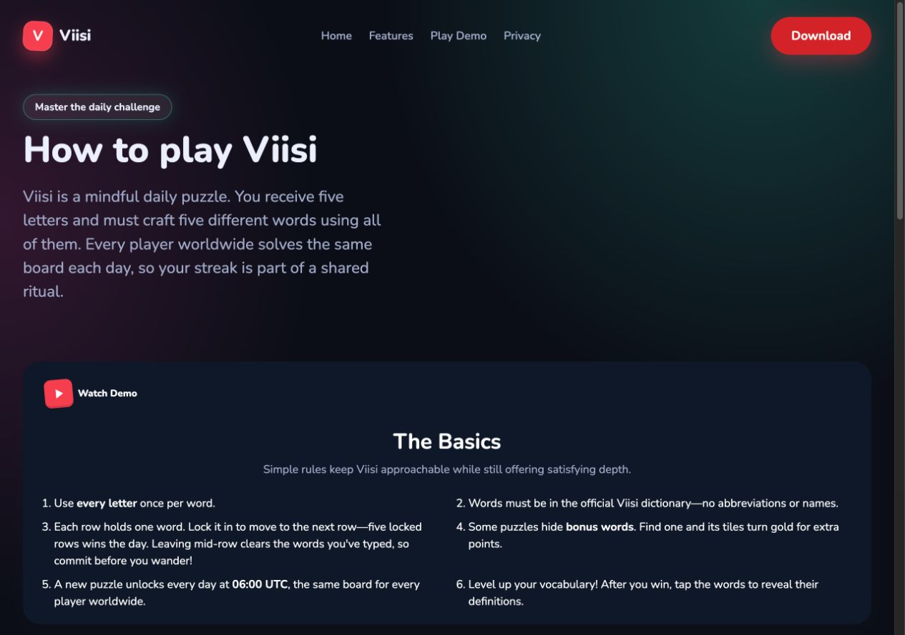

**Step 4 — Scoring.** Formula cards retain their visual hierarchy; repaired markup and wrapping allow the full page to be read at enlarged text sizes.

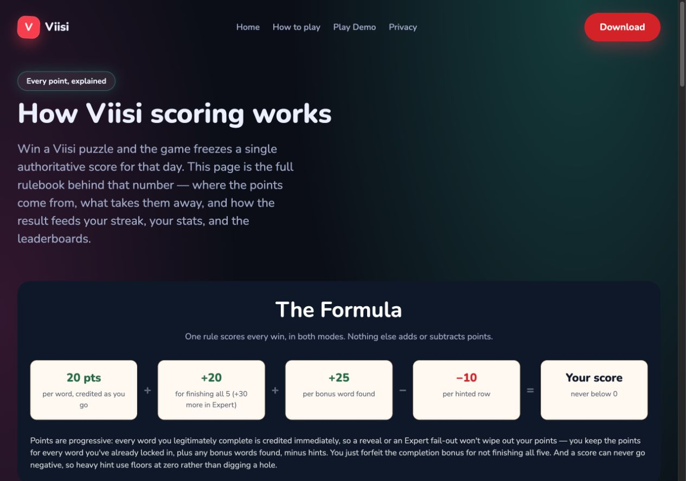

**Step 5 — Badges.** Darker green improves badge-label contrast, and descriptions can wrap without forcing horizontal overflow.

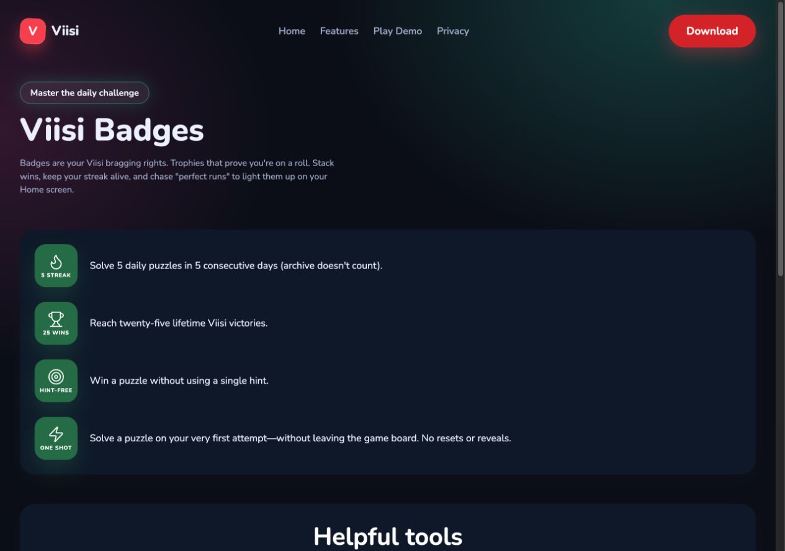

**Step 6 — Privacy.** The policy retains a readable light surface, semantic headings, and underlined contact links. Enlarged-text wrapping and skip navigation were checked separately.

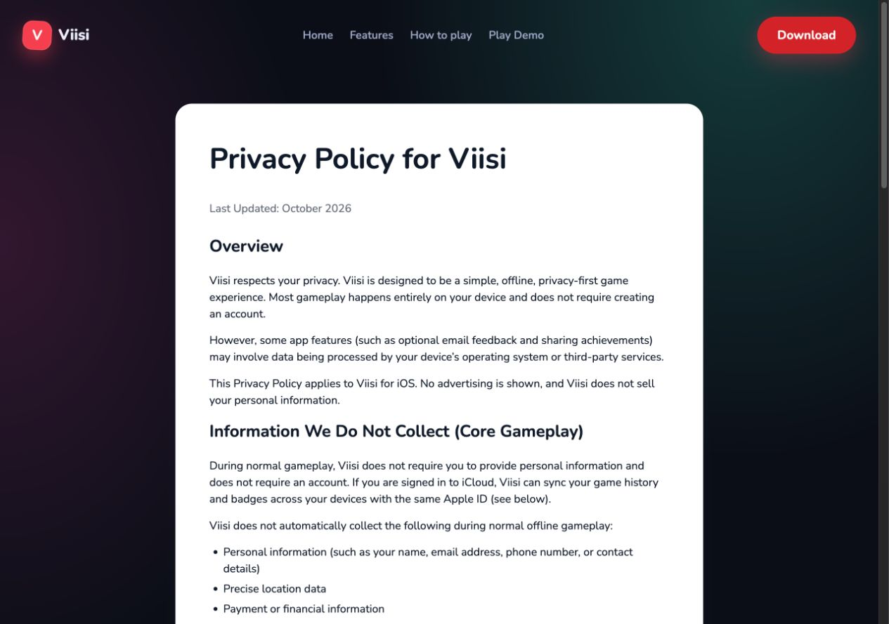

**Step 7 — Comparison.** Table headers identify the columns and rows; a named focusable region supports keyboard scrolling when necessary. FAQ disclosures remain native controls.

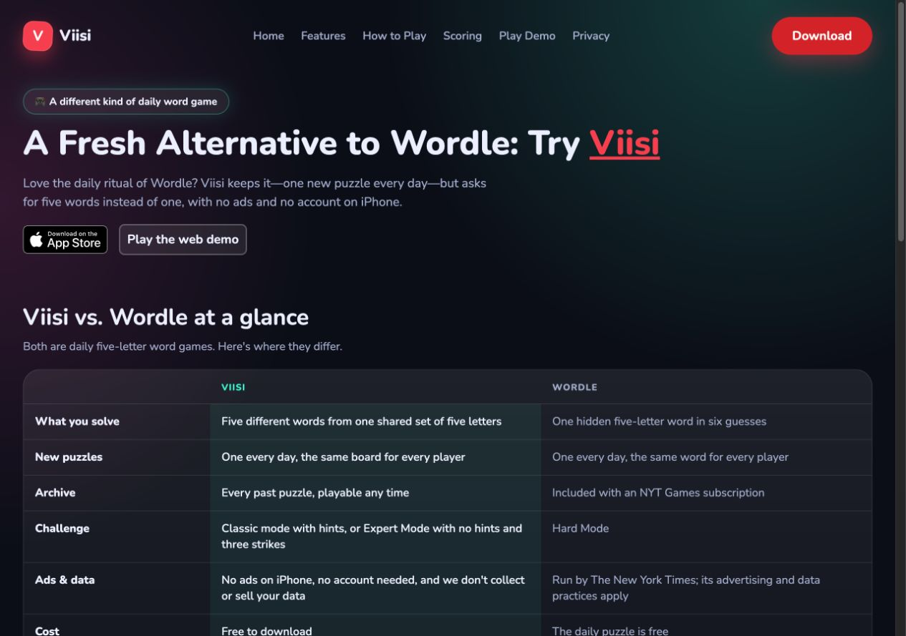

**Step 8 — Legacy preview.** The formerly unidentified page now has a title, visible heading, and a working return link. Its legacy illustration remains visually minimal.

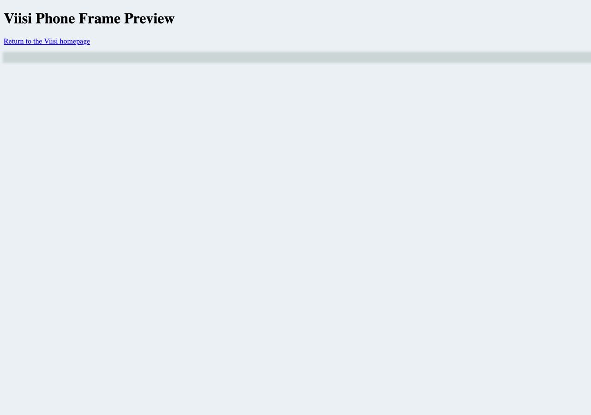

Before-change references retained for the highest-impact steps:

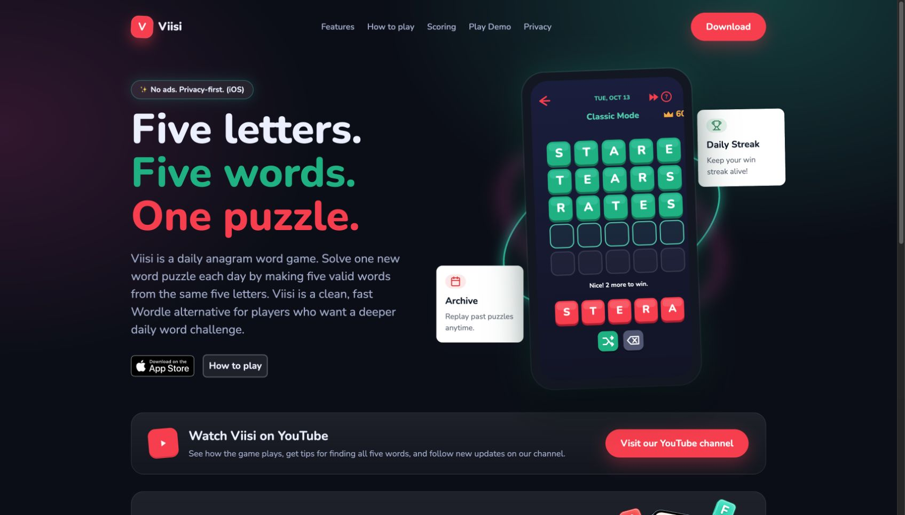

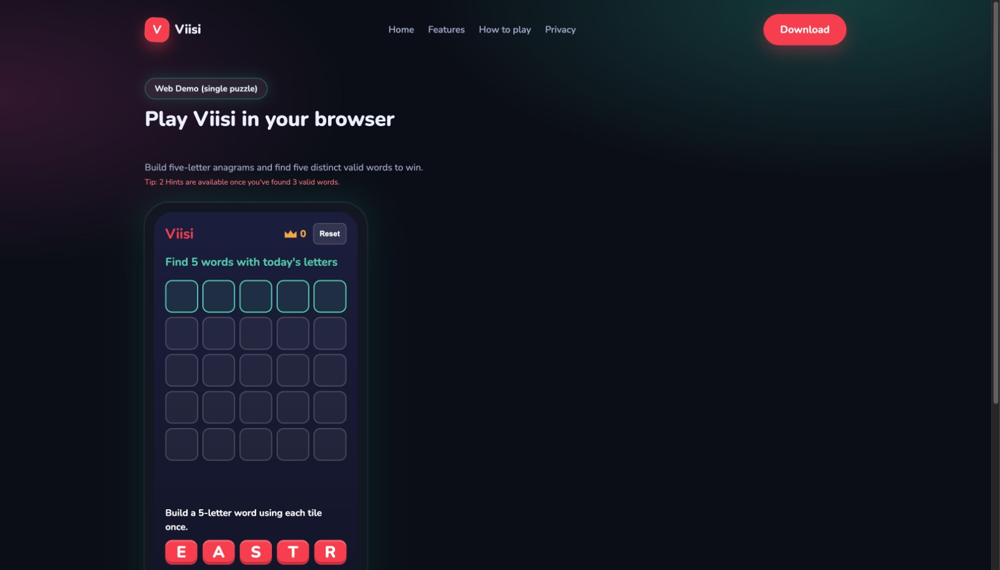
