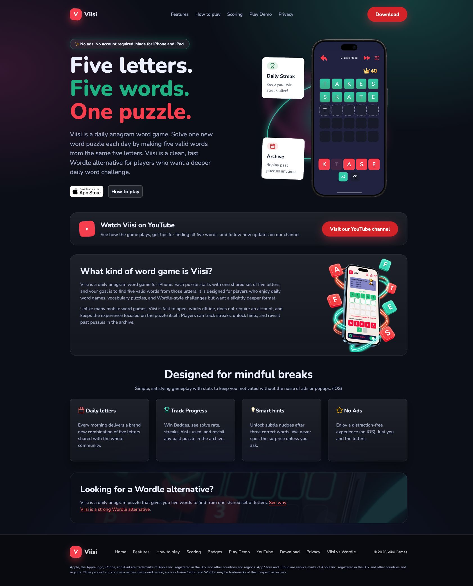
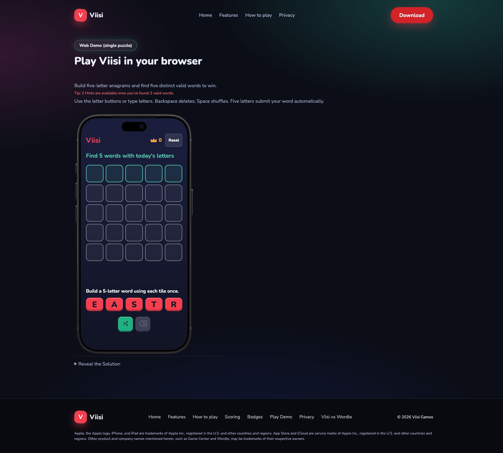
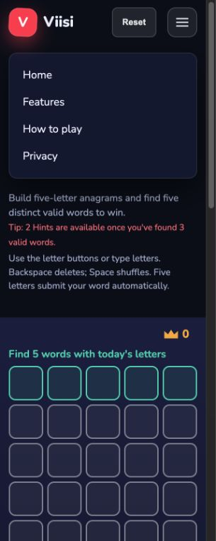
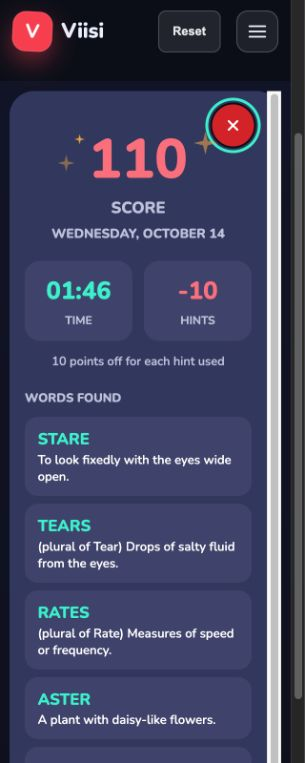
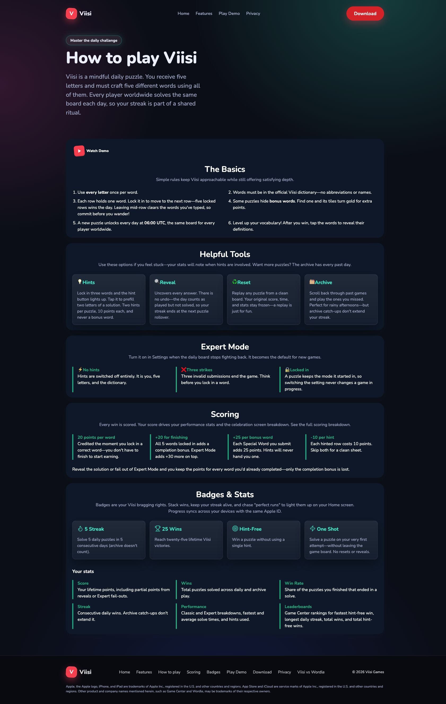
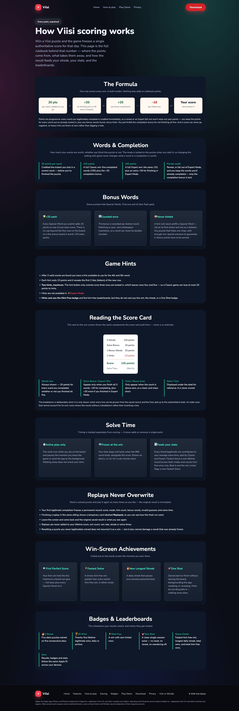
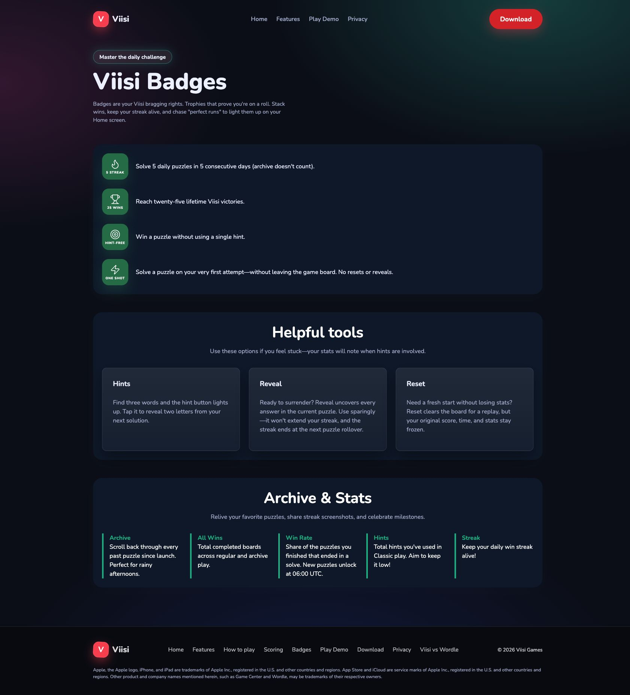
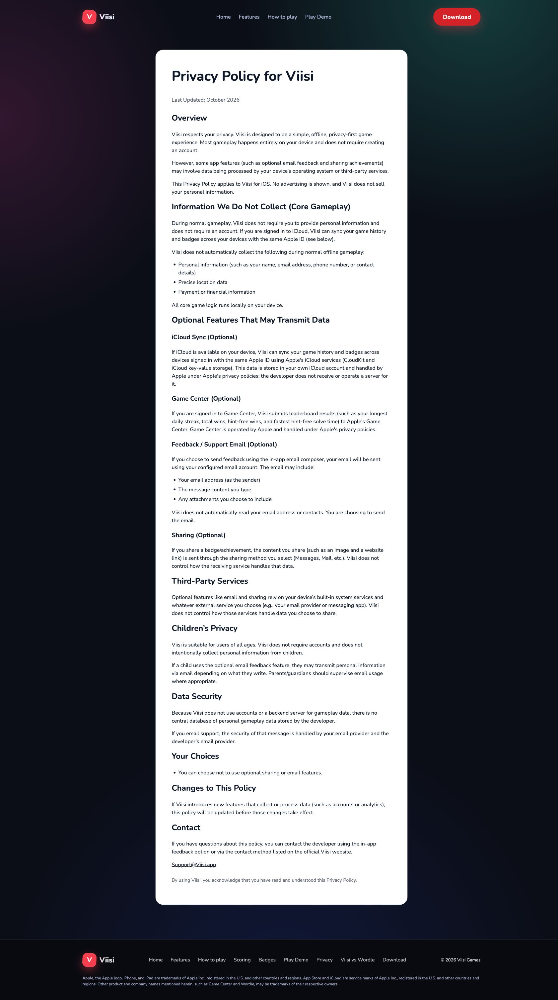
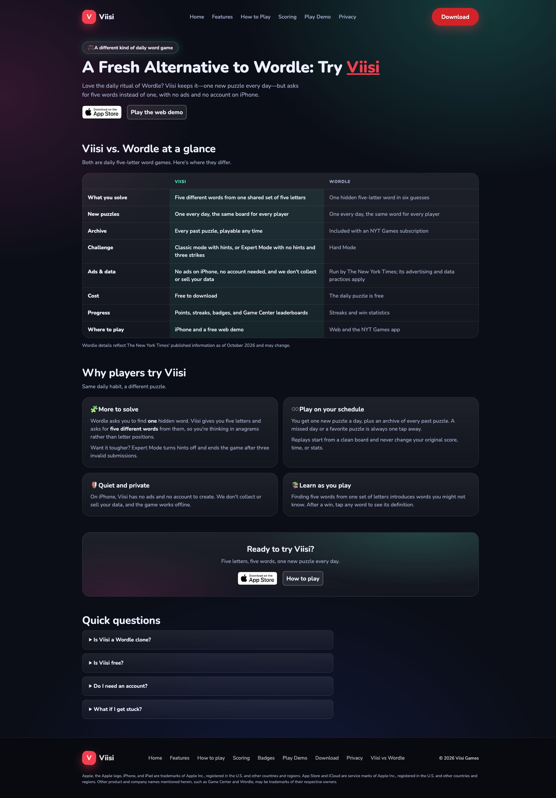
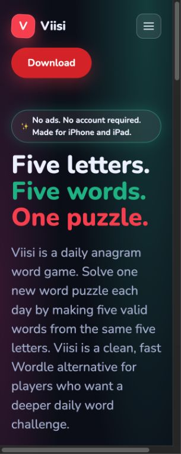

# Viisi accessibility and best-practice review

Reviewed October 14, 2026, against WCAG 2.2 A/AA, including criteria originating in WCAG 2.0 and 2.1. Scope: the current local checkout served at localhost:4173. This is a targeted audit, not a conformance certification or a review of the native iOS app. No application files were changed.

The site has a good accessibility foundation, but the homepage's uncontrolled carousel and the guide's visually indistinguishable link need attention. A reproduced focus-return bug also affects the demo's results flow.

## Prioritized findings

### 1. High: automatic homepage carousel has no pause control

**Step 1; WCAG 2.2.2, level A.** The phone screenshots automatically change every three seconds indefinitely while the rest of the page is available. There is no visible pause, stop, or hide control. The screenshot container being `aria-hidden` does not remove the distraction for sighted users. Reduced-motion support is useful, but visitors need an accessible way to control the carousel.

Evidence: [carousel script](../../../assets/js/screenshot-carousel.js), lines 9–28; [homepage markup](../../../index.html); captured desktop and mobile home states below. Add a keyboard-accessible pause/resume control or show a static screenshot. If keeping rotation, also react to reduced-motion changes during the session; currently the preference is read only at initialization.

Reference: [W3C: Pause, Stop, Hide](https://www.w3.org/WAI/WCAG22/Understanding/pause-stop-hide.html).

### 2. Medium: guide's scoring link looks like ordinary text

**Step 3; link identification/accessibility issue.** “See the full scoring breakdown” has the same computed color (`rgb(170, 179, 209)`), weight (`400`), and no underline as the surrounding paragraph. The screenshot confirms the link has no persistent visual distinction. People reading visually cannot readily tell it is actionable.

Evidence: [guide markup](../../../how-to-play.html), line 236; global `a { color: inherit; text-decoration: none; }` in [shared CSS](../../../assets/css/styles.css), line 107. Underline inline prose links using the existing design language. This is an identification issue; do not describe it as a measured text-contrast failure. [W3C's guidance on distinguishing links](https://www.w3.org/WAI/WCAG22/Understanding/use-of-color.html) is relevant.

### 3. Medium: closing results can lose keyboard focus

**Step 2 and results substep; confirmed interaction bug, WCAG 2.4.3 risk.** Reproduction:

1. Enter STARE, TEARS, and RATES through the keyboard.
2. Activate Hint with Space; it prefills AS and announces the hint.
3. Keep focus on Hint and type TER to finish ASTER, then TARES to win.
4. Results opens and correctly focuses Close results.
5. Press Escape. The dialog closes, but `document.activeElement` is BODY rather than a useful game control.

The Hint control becomes invisible upon winning. By the time `showWin` records the return target, the browser can already have moved focus to BODY. `hideWin` checks that the saved element exists and is connected, but does not check whether it is a usable focus target or whether `.focus()` succeeded.

Evidence: [demo JavaScript](../../../assets/js/demo.js), `renderKeyboard`, `showWin`, and lines 914–917; live keyboard reproduction and native accessibility tree. Use a visible, enabled Reset control as fallback and verify focus actually lands on the intended element. The dialog otherwise passed the tested Tab containment, Escape dismissal, accessible name, and inert-background checks.

Reference: [W3C modal-dialog focus guidance](https://www.w3.org/WAI/ARIA/apg/patterns/dialog-modal/).

### 4. Medium: decorative rings create horizontal homepage scrolling

**Step 1/mobile substep; responsive best-practice issue and reflow risk.** At a 320 × 800 viewport, Chrome's content width was 305px because of its scrollbar, while document/body scroll width was 348px. A horizontal scrollbar is visible. The rotating phone rings remain 340px wide even when their container is 265px wide.

Evidence: [shared CSS](../../../assets/css/styles.css), lines 1505–1514; mobile home screenshot below. Constrain or clip the decorative ring layer within its own container. Do not suppress overflow globally, since that can conceal meaningful content or focus indicators. Since the observed overflow is decorative and the text remained available, this audit does not label it a proven WCAG 1.4.10 failure.

### 5. Medium: invalid CSS silently discards intended styling

**Steps 3–5; maintenance/rendering issue.** [Shared CSS](../../../assets/css/styles.css) contains JavaScript-style `//` comments inside `.video-pill` at lines 57–60 and a missing semicolon after `.stat strong`'s `font-size` at line 1047. CSS does not interpret `//` as a comment; declarations can be discarded during parser recovery. The missing semicolon combines the font-size and font-weight tokens into an invalid declaration. This explains why the stat labels do not receive their intended typography.

Use valid CSS comments and terminate declarations. These are specific syntax problems, not a request for broad styling changes.

### 6. Lower priority: mobile navigation and content usability

**Steps 2, 3, and 7.** The demo hides both the Download button and the footer at mobile widths, while its mobile menu contains only Home, Features, How to play, and Privacy. Download and Scoring are consequently unavailable directly from that screen. Keep key destinations available in the mobile menu. Other pages also offer different subsets of navigation; a shared, consistent set would reduce orientation effort. This alone is not asserted as a WCAG 3.2.3 violation: repeated items generally retain their relative order.

The comparison table retains real column and row headers, which is good. At 320px, its narrow columns break labels such as “Challenge” and “Progress” across lines and produce very tall rows. Consider a small-screen presentation that preserves each feature and the two named comparisons. This is a usability improvement rather than a demonstrated reflow failure.

### 7. Lower priority: performance, discoverability, and disclosure

**Steps 1 and 6 plus source inspection.** The twelve carousel JPEGs total approximately 2.76 MB; the decorative phone PNG is approximately 888 KB. These are source asset sizes, not a measured network waterfall or Core Web Vitals result. Provide appropriately sized/compressed formats and avoid downloading an unused theme's carousel. The above-the-fold App Store badge is marked lazy-loaded; eager loading would avoid deferring that primary action.

The sitemap includes the internal `component.html` phone-frame preview and has stale modification dates. Exclude the preview if it is not meant for visitors; update dates accurately. The preview also attempts to load `https://cdn.tailwindcss.com` as a stylesheet, although this is a script endpoint; this was identified in source, not tested as a deployed network failure.

The privacy page explicitly applies to the iOS app, while the web demo writes puzzle progress to localStorage and the site requests Google Fonts. Add a short website/demo disclosure that describes those actual behaviors. This is a clarity recommendation, not legal advice or a finding about the native app's data handling.

## Checks that passed within the tested scope

- The seven main pages have language declarations, descriptive titles, one h1, and labeled navigation/main landmarks.
- The homepage skip link moved focus to `main-content`.
- Mobile navigation opens with accurate expanded state; Escape closes it and returns focus to its toggle. Hidden menu links do not appear in the native accessibility tree.
- Demo letter input, Backspace deletion, accepted-word state, hint availability after three words, and hint announcement worked. Letter controls preserve focus across renders.
- Five accepted words with one hint produced 110 points in both the live score and accessible results text.
- The results dialog has an accessible name, exposes the final score separately from visual count-up, hides inert background content from the native accessibility tree, wraps Tab to its only control, and dismisses with Escape.
- Tested main buttons are adequately sized for WCAG 2.2's 24px minimum; footer links have spacing that must be considered before treating their approximately 23px height as a failure. 44px is an enhanced target, not the universal AA threshold. [W3C target-size guidance](https://www.w3.org/WAI/WCAG22/Understanding/target-size-minimum).
- Spot contrast calculations: white on primary-button red `#dc2626` = 4.83:1; dark demo letters `#0a192e` on `#fb4655` = 5.13:1; muted privacy text `#6b7280` on white = 4.83:1. These pass normal-text requirements; this was not a complete contrast scan of every state/background/image.
- Static HTML checks found no missing local file references, missing img alt attributes, or duplicate IDs. The eight missing `#reviews` references are currently hidden links, recorded as cleanup items rather than visible broken navigation.

## Captured steps and general health

1. **Homepage: needs attention.** Strong heading hierarchy and clear download action; carousel control and decorative overflow need work.
   
2. **Playable demo and results: mostly healthy, with a focus-return bug.** Keyboard play, hints, score, and dialog containment worked. Mobile direct download navigation is missing.
   
   
   
3. **How to play: mostly healthy.** Structured rules and headings; inline scoring link needs persistent visual distinction.
   
4. **Scoring: mostly healthy.** Clear formula, explanatory text, and example breakdown; shared CSS has discarded typography declarations.
   
5. **Badges: mostly healthy.** Badge text accompanies icons; content remains available at narrow widths.
   
6. **Privacy: mostly healthy for reading.** Readable contrast and structured sections; website/demo disclosure would improve clarity.
   
7. **Viisi/Wordle comparison: mostly healthy.** Semantic table and native FAQ disclosures; narrow columns make scanning harder.
   
8. **Mobile homepage: needs attention.** Content wraps; decorative rings cause horizontal page scrolling.
   

## Verification and limits

Commands/checks run:

- `python3 -m http.server 4173`: local site served successfully.
- Chrome browser review: seven public content pages, desktop and 320 × 800 viewport. Native accessibility-tree and computed-DOM checks supplemented screenshots.
- Inline Python HTMLParser audit of all nine HTML files: no missing local files, missing img alt attributes, or duplicate IDs; eight hidden missing `#reviews` fragment references. Output: `static-checks.json`.
- Inline Python WCAG relative-luminance calculations: spot ratios listed above.
- `node --check` for `assets/js/main.js`, `demo.js`, `screenshot-carousel.js`, and `phone-animation.js`: all passed with Node v24.1.0.
- Report local-link check: passed. Screenshot file-type inspection confirmed valid JPEG captures; extensions match their format.
- `git diff --check`: passed.
- Formatter/linter/typechecker/test suite: none configured in this static repository; `tmp-demo.spec.js` is an old standalone animation script, not a configured test suite. No new test infrastructure was added.
- Browser tooling limits: one `pressSequentially` attempt timed out and a locator evaluation timed out; native individual key presses and direct read-only DOM inspection completed the intended checks. The read-only browser environment did not expose Performance API access, so no network timing claims are made. Some full-page mobile demo captures showed animation/capture artifacts and were rejected; accepted mobile menu/results screenshots use viewport captures.

Not verified: VoiceOver/NVDA spoken output, touch use on physical iOS/Android devices, Safari/Firefox, light-mode and forced-colors rendering, live reduced-motion preference switching, 200% text resize, actual 400% browser zoom, WCAG text-spacing overrides, full contrast coverage, video captions/audio descriptions, deployed-site parity, security headers, external-link availability, and real Core Web Vitals. Narrow viewport checks are useful reflow evidence but do not substitute for all zoom and text-spacing tests. No axe/Lighthouse scan was run.

Changed files: this report, `page-checks.json`, `narrow-checks.json`, `static-checks.json`, `interaction-checks.json`, and accepted screenshots under this new review directory. Earlier audit artifacts were left intact. No source edits, commits, or deployments. Risks/follow-ups: fix findings 1–5, then complete assistive-technology, text-resize/spacing, and theme checks before making a conformance claim. No repository-guidance conflicts found.
